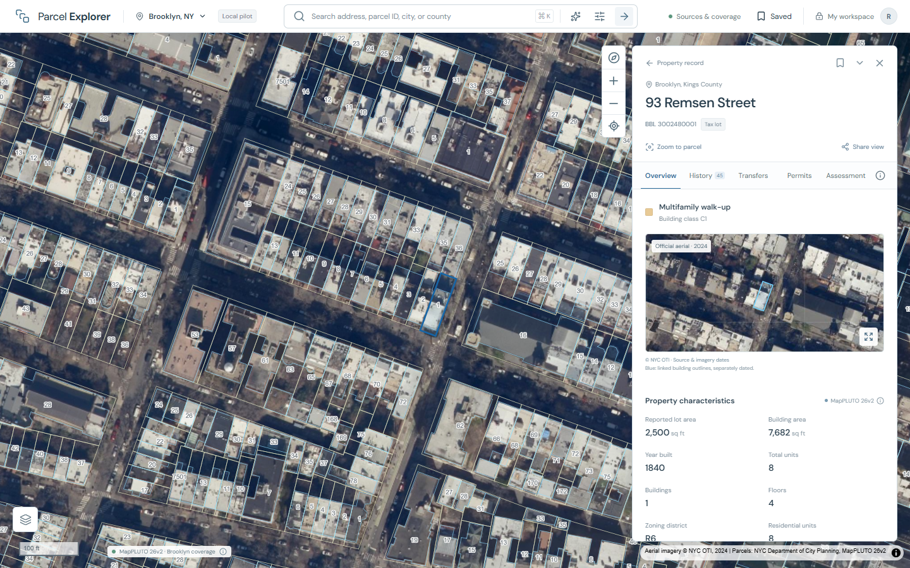
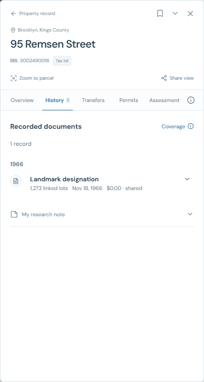
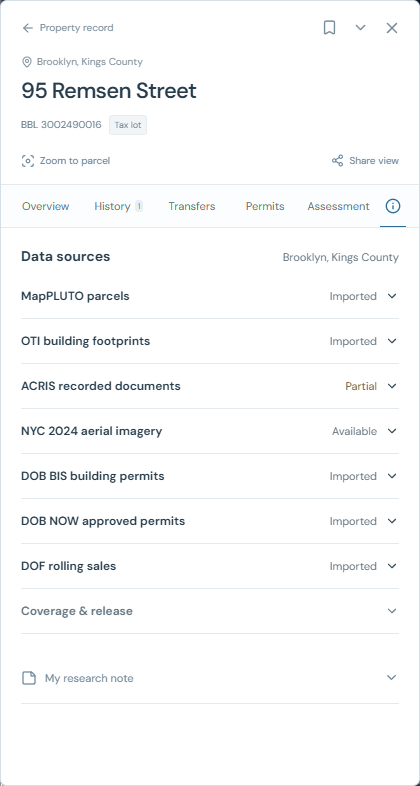
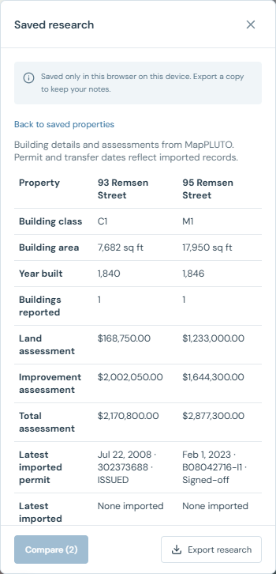
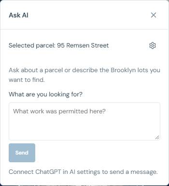

<div align="center">
  <h1>Parcel Explorer</h1>
  <p><strong>Research Brooklyn properties from the map to the original record.</strong></p>
  <p>Next.js · React · MapLibre GL · Python · SQLite</p>
</div>

Parcel Explorer is a local-first workspace for researching Brooklyn tax lots. Search by address or borough-block-lot ID, select a parcel on the map, and review its buildings, assessments, recorded documents, permits, and transfers alongside source links.

**Status:** Working local pilot for Brooklyn. The data reflects imported snapshots, with coverage dates and gaps shown in the app.

[Watch the demo](docs/media/walkthrough.mp4) · [Run locally](#run-locally) · [Data coverage](#data-coverage) · [Verification](#verification)

[](docs/media/walkthrough.mp4)

*25-second walkthrough of the parcel map, recorded documents, permits, assessments, saved comparisons, and the Ask AI panel.*

## The research workflow

1. Search an address or BBL, or apply property filters. Use **Limit to map view** to search the visible area.
2. Click a parcel to open its inspector. Switch between aerial imagery and the street map in **Map layers**.
3. Browse the document, permit, and transfer timelines. Expand an entry for source details and the official link.
4. Open **Transfers → Nearby sales** to review comparable imported sales. Bookmark two or three lots and use **Saved → Compare** to review them side by side.
5. Keep research notes in the browser or export a copy. Use **Ask AI** for questions about the selected parcel or to turn a plain-language lot search into editable filters.

## What works today

| Feature | How it works |
| --- | --- |
| Parcel map | MapPLUTO vector tiles, OTI building outlines, and 2024 NYC aerial imagery |
| Property inspector | Building IDs, physical characteristics, assessment breakdown, and source coverage |
| Document history | Dated ACRIS records and expandable linked-lot lists for filings that span multiple lots |
| Permits | DOB BIS and DOB NOW timelines, source links, and copyable DOB NOW job IDs |
| Nearby sales | Dated, positive-price lot sales in the same building class, within one mile and within 50% of the subject’s building area |
| Saved comparison | Two or three lots side by side, including assessments and the latest imported permits and transfers |
| Ask AI | One chat for parcel questions and lot search. Review suggested filters and unsupported criteria before applying them |

### Document history



### Sources and coverage



### Saved comparison



### Ask AI



AI is optional. Open the gear menu inside **Ask AI** to connect an eligible ChatGPT account. A configured server-side `OPENAI_API_KEY` and `PARCEL_ASSISTANT_MODEL` are an alternative that uses the API project’s billing. The assistant sends your submitted question and relevant public records to OpenAI. Private research notes stay in the browser. Connections are kept in server memory and need reconnecting after expiry or a restart.

## Run locally

Use Windows PowerShell, Node.js 20.9 or later, and Python 3.10 or later. The app and its optional API bind to loopback.

```powershell
npm ci
python -m pip install -r requirements.txt
```

### Prepare data on a fresh checkout

Runtime databases, source snapshots, tiles, and credentials are excluded from Git. For an existing installation with a published release, skip to **Start the app**. A fresh checkout needs a seed release before the borough import.

```powershell
python -m services.ingestion.import_pilot
npm run tiles
python -m services.ingestion.import_pilot --publish
```

For borough-wide coverage, run the following from the repository root. The source downloads resume from checkpoints and need local disk space. The activation step switches the published release after validation.

```powershell
python -m pip install --target data/brooklyn-deps shapely==2.1.2
python -m services.ingestion.brooklyn_fetch
python -m services.ingestion.brooklyn_release
node --max-old-space-size=6144 scripts/build-tiles.mjs
python -m services.ingestion.brooklyn_release --publish
```

### Start the app

```powershell
npm run build
python scripts/serve_local.py
```

Open [127.0.0.1:3100](http://127.0.0.1:3100/). On Windows, `Start-ParcelExplorer.ps1` can launch an existing build. To use the separate read-only FastAPI service, run `python -m uvicorn services.api.main:app --host 127.0.0.1 --port 3101` and open its [API documentation](http://127.0.0.1:3101/docs).

## Data coverage

The Brooklyn release used for these screenshots contains **275,628 tax lots**, **330,058 linked building footprints**, and **1,936,760 imported records**. Use **Sources & coverage** for the active release and exact dates.

- ACRIS borough imports cover eligible records from 2016 onward, plus earlier records retained from targeted imports.
- Sales use the NYC DOF rolling feed. An empty comparable list means no imported sale met the filters.
- Records join by exact BBL. Historic lot changes and condo-unit associations can leave gaps.
- Shared filing amounts apply to the document as a whole. Assessments are source observations, separate from market value or sale price.
- Notes and bookmarks are stored by the current browser and origin. Export research for a portable copy.

See the [source register](docs/source-register.md) and [product specification](docs/product-spec.md) for source provenance and planned scope.

## Verification

```powershell
python -m pytest tests -q
npm test
npm run typecheck
npm run build
# With the local app running and agent-browser available
python tests/browser_smoke.py
```

The browser smoke test uses an isolated session. Live ChatGPT eligibility depends on the connected account and workspace. The app’s deterministic search and record views work without that connection.

## Repository layout

| Path | Contents |
| --- | --- |
| `apps/web` | Map, search, property inspector, saved comparisons, and Ask AI |
| `services/ingestion` | Snapshot downloads, record normalization, and release assembly |
| `services/api` | Read-only SQLite queries, optional FastAPI endpoints, and assistant backend |
| `scripts` | Tile builder and loopback app launcher |
| `tests` | Backend, search, and browser checks |
| `docs` | Product specification, source register, and screenshots |
