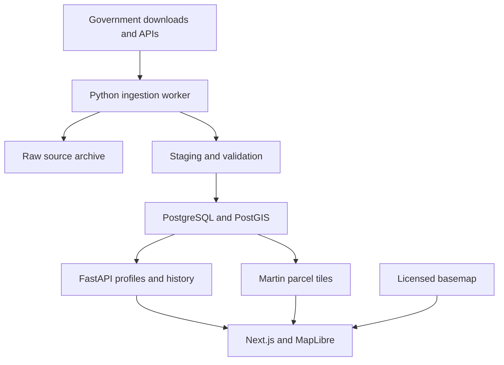

# Parcel Explorer — Full Product and Technical Specification

**Version:** 1.2  
**Prepared:** November 4, 2026  
**Updated:** November 5, 2026 — search promoted to a primary product flow, with linked results, filters, and explicit map-area search.  
**Status:** Implementation specification; application development and live imports have not been performed for this document.  
**Product:** A standalone, map-first government parcel research application. “Parcel Explorer” is a working name.

## 1. Product definition

Build a web application in which a user searches for properties or explores a map, selects a matching parcel, and reviews the government records linked to that property. Search and the map are the two primary entry points: a persistent search bar, criteria filters, and a linked result list make properties discoverable without already knowing where to click. The application collects public parcel boundaries, property attributes, assessments, recorded transfers, document references, and permit records from supported jurisdictions. It organizes those records into a source-backed property profile and timeline.

The product promise is **available government-record history with explicit source, date, and coverage information**. The application must not imply that every historical event is digitized, that every jurisdiction supplies the same fields, or that a current parcel boundary is the boundary that existed when an older document was recorded.

The principal experience is the map. The supplied interface reference is [NJOGIS Property Explorer](https://newjersey.maps.arcgis.com/apps/webappviewer/index.html?id=3a4290e1b3d64094a8b8a127965ab43a), together with the user's screenshot: a nearly full-screen parcel map, detailed boundary/lot labels, compact tools, and information revealed when a parcel is selected. This establishes the application's information hierarchy and interaction direction. Section 3 specifies how to add deeper records while keeping the map visible. Final branding, colors, and component styling remain design decisions. [S18]

### 1.1 Initial geographical scope

Treat New Jersey and New York as the target region, and release one jurisdiction adapter at a time:

1. **First release: Brooklyn / Kings County, New York City.** Start with one borough's parcel footprints, attributes, sales, and recorded-document metadata. This is a recommendation based on the combination of structured official sources available.
2. **Second release: Hudson County, New Jersey, beginning with Jersey City.** Import county parcels, available assessment editions, SR1A transfers, and available recent permits.
3. **Expansion:** other NYC boroughs and NJ counties, followed by selected non-NYC New York counties after a source audit.

NYC is not interchangeable with New York State. Staten Island also requires a separate recording-source adapter. Published state parcel coverage and county permissions must be checked before each expansion. [S4, S13]

### 1.2 Release boundaries

| Release | Included |
|---|---|
| Thin working prototype | Real government parcel polygons for Brooklyn, address/BBL search, selection panel, current attributes, a bounded sales/document history import, official source links, visible coverage. |
| First usable research release | Reliable recurring imports, related-property handling, assessments/snapshot history where supported, DOB permit sources, filters, private bookmarks/notes, provenance, admin import status, mobile support, backups. |
| NJ extension | Hudson/Jersey City adapter, NJ identifier mappings, MOD-IV history, SR1A history, available permits, source redaction handling, recorder links. |
| Later depth | Older archives, historical geometry layers, additional county document access, zoning overlays, optional OCR, broader geography. |

The initial application does not include wholesaling valuations, repair estimates, lead pipelines, subscriptions, or white-label functionality. These are independent future product decisions.

## 2. Verified source strategy

Use government bulk downloads and documented APIs first. HTML scraping is a fallback for an otherwise unavailable, permitted public source. A map click reads the application's database; it must never initiate a county-website crawl.

The following inventory was checked against official catalogs, metadata, documentation, and published schemas. It is not a claim that every archive has already been downloaded or every API request successfully executed. The first implementation milestone must test actual extraction and joins.

### 2.1 New York City

| Source | Records and access | Identifier and coverage requirements |
|---|---|---|
| PLUTO — `64uk-42ks` | Tax-lot attributes through NYC Open Data / DCP downloads; address, building and land characteristics, land use, assessment-related attributes, and zoning fields. DCP provides previous releases. | Join by BBL. A release is a source snapshot, not a comprehensive event log. Preserve the actual release version and field meanings. [S1] |
| MapPLUTO — `f888-ni5f` | Parcel/billing-footprint geometry with PLUTO attributes; official GIS packages. | Resolve and verify the actual download vintage. Do not join an old geometry release to newer attributes while presenting both as one dated snapshot. [S2] |
| ACRIS Master — `bnx9-e6tj` | Document ID, type, document date, recording date, amount, and revision fields. Published as a structured dataset. | Join to Legals and Parties using `document_id`. The amount field is not automatically a sale price. [S3] |
| ACRIS Legals — `8h5j-fqxa` | Property associations for recorded documents. | Construct the property BBL from Legals borough/block/lot. Preserve one document linked to multiple properties. Master’s recording-borough field is not a substitute. [S3] |
| ACRIS Parties — `636b-3b5g` | Parties associated with a document and their recorded roles. | Store document parties separately from tax-record owner fields. Do not infer current or beneficial ownership solely from a party name. [S3] |
| DOF annual and rolling sales — rolling ID `usep-8jbt` | Recorded sale/transfer rows; annual downloads begin in 2003, and rolling files cover the preceding twelve months. | Preserve sale date, price, property classification, apartment/unit fields, and source row. Reconcile overlapping annual and rolling files. Zero-dollar/noncash transfers remain visible as classified transfers. [S5] |
| DOB permits — BIS `ipu4-2q9a`, DOB NOW `rbx6-tga4` | Building permit issuance and approved-permit records; the official index also lists historical and specialized datasets. | Import both main families, retain BIN and BBL, and document excluded permit categories. A permit lifecycle can be updated in place. [S6] |

**ACRIS boundary:** the official service covers Manhattan, Bronx, Brooklyn, and Queens from 1966 onward. That establishes published source availability, not automatic import completeness. Staten Island recorded documents and pre-1966 research require different routes. Start the prototype with a clearly labeled bounded import, such as 2016 onward, then expand the backfill. [S4]

For that initial window, include ACRIS documents by **recording/filing date** from January 1, 2016, then attach Legals and Parties using the selected Master document IDs. Include DOF sales by reported **sale date** from that date. Track corrections by revision/update evidence regardless of the original event date. Coverage records must state their `date_basis`; an old document recorded within the window must not be excluded merely because its document date is older.

**Assessment boundary:** PLUTO snapshots can show source-observed assessment values. Do not call those a complete annual tax-roll history or an actual tax bill. If the product requires authoritative annual assessment history, add the applicable DOF valuation/assessment feed after validating its tax-year semantics and coverage. A downloaded PLUTO release year must not be invented as an assessment year.

### 2.2 New Jersey

| Source | Records and access | Identifier and coverage requirements |
|---|---|---|
| NJGIN parcels / joined MOD-IV | County/state FileGDB downloads and a current ArcGIS hosted feature service. Provides parcel geometry and selected tax attributes. | Preserve municipality, block, lot, qualifier, source IDs, and geometry vintage. The hosted source is not a complete historical boundary archive. [S8] |
| Hudson County parcel package | Official county parcel download with MOD-IV relationships. | Metadata documents duplicate identifiers, unmatched rows, and multiple-lot sites. Publication date can be newer than the tax data represented. [S9] |
| Treasury MOD-IV assessment files | Annual official bulk files and published layout. The reviewed catalog lists 2021–2026. | Use actual tax year; preserve the original row and source publication date. Annual lists do not represent every subsequent change. [S10] |
| Treasury SR1A sales files | Annual and YTD bulk transfer files; the reviewed catalog lists 2020–2026 and YTD. | Parse the published fixed-width layout. Preserve reported/verified amounts, deed and recording dates, classification, and additional-lot associations. [S10, S11] |
| NJ Construction Permit Data — `w9se-dmra` | Monthly structured state dataset covering most municipalities. | It removes records 60 months after receipt and lacks property addresses, geocoding, owner names, and detailed work descriptions. Join parcels using `treasurycode` plus block/lot; retain `comu` plus `recordid` as source record identity. These municipality-code namespaces differ. [S12] |
| Jersey City municipal parcels | City-hosted parcel exports include current and historical identifier fields. | Evaluate old block/lot fields as crosswalk evidence. Their presence does not prove complete parcel lineage. [S14] |
| Hudson County Register | Official recorded-document search and document viewing. | Initial release links to the official portal. Bulk/API access, automation conditions, and online historical coverage require separate confirmation. [S15] |
| Rutgers MOD-IV archive | Public-university historical tax data repository describing records from 1989 onward. | Optional later backfill. Registration and download conditions apply; coordinate large imports instead of assuming unlimited bulk scraping. [S16] |

**NJ owner-name policy:** NJOGIS states that owner names are redacted from its hosted parcel and tax-list downloads, services, and applications. The UI must preserve this state, including when older source snapshots are retained. Do not reconstruct a deliberately suppressed identity by combining other feeds. [S8]

**NJ join policy:** Keep municipality, block, lot, suffixes, and qualifier as text. `PAMS_PIN` can be duplicated, and county updates can regenerate `PCL_GUID`. Use an internal identity with source-aware identifier mappings. The Hudson metadata records a Jersey City block/lot renumbering effective February 2012, demonstrating why old identifiers need separate treatment. [S9]

The processed MOD-IV `GIS_PIN` corresponds to normalized parcel `PAMS_PIN`; use `PIN_NODUP` for duplicate-aware matching where populated and applicable to the source edition. Require an unambiguous association and retain unmatched rows. A permit without a condo qualifier must not be attached automatically to every unit sharing its block/lot. [S9, S12]

### 2.3 New York State outside NYC

Use the NYS parcel program and county sources after the pilot. Preserve `SWIS`, `SBL`, `PRINT_KEY`, municipal parcel IDs, roll year, and spatial year. Public polygon availability varies by county; statewide centroid coverage does not mean statewide public boundary coverage. Metadata can have inconsistent edition descriptions, so validate downloaded row-level vintages and record discrepancies. [S13]

### 2.4 Source access register

Before enabling any connector, record:

- Agency, source URL, dataset ID, contact route, and source type.
- API/download access method, any registration/token requirements, and published limits.
- Reuse/attribution requirements, retention conditions, and redaction behavior.
- Declared update cadence, observed update cadence, and actual imported coverage.
- Published schema/layout, adapter/parser version, and extraction test result.
- Last check time, last successful fetch, last successful publish, and last source change.

Public visibility and permission to bulk download or republish are separate matters. Prefer explicit open-data exports; use official document links when image redistribution has not been established.

## 3. User experience and functional requirements

### 3.1 Main map

The application opens directly into a parcel map that fills the viewport beneath a compact header. The map remains mounted while the user searches, selects properties, changes tabs, and reads records. Controls and research panels open over or alongside that persistent map.

The NJOGIS reference establishes the desired visual hierarchy: fine parcel outlines, readable lot labels, stronger block boundaries where supplied, street names, municipality context, a restrained selected-parcel outline, and compact controls. These are observations of the supplied screenshot; they are not a claim that every layer or historical field in the live reference application was tested. [S18]

#### Desktop layout

| Element | Requirement |
|---|---|
| Main canvas | Fill the application area. When no property or tool panel is open, expose virtually the full map. |
| Header | Approximately 44–52 px high as an initial design target; compact identity, coverage/area selector, and account access. |
| Search | Prominent, always-visible search near the upper-left corner, with address/parcel/place suggestions, scope controls, and access to filters. Full results remain recoverable after property selection. |
| Tool rail | Narrow icon controls for layers, filters, and saved properties. Each opens a dismissible panel. |
| Parcel summary | On click, show a compact inspector with address, jurisdiction, official IDs, and a few key sourced facts. It may be an anchored card or the compact state of the right inspector. |
| Detailed inspector | An explicit “View details” or history action expands the same property into a right-hand drawer. Use a typical width of 360–420 px; on screens at least 1280 px wide, cap it at 30% of viewport width. |
| Available map area | Keep at least 65% of desktop viewport width available for map interaction in the standard detail state. An explicitly requested expanded document/research view may use more space and must restore the prior map state on close. |
| Persistent map utilities | Accessible zoom/reset controls, scale, attribution, and an on-demand legend. Keep them clear of the detail drawer. |

The summary card and detailed drawer are stages of the same selection flow. Avoid simultaneously repeating a large popup and a large drawer for the same property. Tool panels close or collapse when necessary so their combined footprint does not crowd the map.

These dimensions are proposed design requirements, not measurements of the reference site. At intermediate viewport widths, choose a narrower drawer or bottom sheet while retaining the selected parcel in view.

Required behavior:

- Pan and zoom through supported coverage; display a coverage boundary at wider zooms.
- Load parcel outlines only at useful neighborhood/street zoom levels.
- Highlight a hovered parcel and persist a selected parcel across tile loads.
- Click a parcel to fetch its profile without resetting the map camera.
- Distinguish missing coverage from a legitimately empty location.
- Show attribution, scale, and layer/source information.
- Allow parcel, jurisdiction boundary, and optional zoning layers to be toggled separately.
- Provide a list/search alternative to pointer-only interaction.

#### Cartographic detail

- Provide a light parcel-map style as the default: restrained base colors, thin boundaries, and legible road/parcel labels.
- Distinguish parcel and block boundaries where each is supported by imported source geometry. Do not infer legal blocks from arbitrary visual grouping.
- Use progressive labeling: jurisdiction context at wider zooms, parcel boundaries at neighborhood zooms, and lot/block labels at useful close zooms. Tune the thresholds with pilot data and manage label collisions.
- Highlight the selected parcel with a clearly distinguishable outline and light fill so neighboring boundaries and the underlying map remain readable.
- Offer imagery, zoning, and other overlays only when a suitable source and coverage are available; each layer needs its own legend, attribution, and source date where meaningful.
- Make filters visible through map styling and result counts without covering the parcel map with persistent result cards.

At overlaps or condominium footprints, show a chooser for available related entities. Do not arbitrarily display one unit's history as the entire building's history.

#### Selection and navigation states

| State | Map behavior | Information behavior |
|---|---|---|
| Explore | Full map with compact controls | Detail inspector closed. |
| Hover | Subtle boundary highlight | Optional brief address/identifier tooltip. |
| Select | Persist selected outline; retain current camera | Compact summary, source date, and an action to open deeper details. |
| Research | Selected parcel remains visible and the surrounding map stays interactive | Drawer with overview and record/history tabs; independent panel scrolling. |
| Return to map | Restore the prior usable map area | Close the panel without resetting camera or silently clearing selection. |

Selecting a search result or using “Zoom to parcel” can fit that parcel to the available map area. Opening a panel or switching tabs must not repeatedly auto-zoom. Use camera padding and only a minimal adjustment if a panel would cover the selected geometry. Browser navigation and shareable URLs preserve the selected entity and map position; private notes remain outside URL state.

Keep a selected property while panning to inspect nearby lots. Clearly indicate the selected property when it moves outside the viewport and provide a recenter action. Selecting another parcel replaces the inspector content without remounting the map; discard stale responses from the prior selection.

### 3.2 Search

Search is a primary product feature. Keep the main input visible when the map first opens and while users inspect a property. Suggested placeholder: **“Search address, parcel ID, city, or county.”** Users can either find a known property or discover properties through location and criteria.

#### Supported search modes

| Mode | Required behavior |
|---|---|
| Address lookup | Match full/partial imported street addresses and supplied unit identifiers; suggest candidates with locality and property type. |
| Official parcel lookup | Accept NYC BBL or NJ municipality/block/lot/qualifier; offer structured fields for identifiers that need jurisdiction context. Preserve leading zeros and suffixes. |
| Place lookup | Suggest supported cities/municipalities/counties. Selecting one sets the jurisdiction filter and fits its coverage; it does not only move the camera. |
| Property discovery | Combine location with supported property class, lot area, assessed value/year, latest imported transfer date, and available-record filters. |
| Search this area | Commit the visible map bounds as the spatial search scope and update both the results list and matching map features. |

An exact official ID ranks first, followed by stronger address matches and then partial/fuzzy candidates. Where identical addresses occur in several municipalities, show the alternatives rather than choosing silently. Government addresses and jurisdiction records form the initial index; a separately licensed geocoder can later extend navigation. A geocoded point does not establish a verified parcel match.

#### Suggestions, results, and map interaction

- Offer debounced autocomplete with a small bounded suggestion set, keyboard navigation, Enter selection/submission, and clear place-versus-property labels.
- A submitted search opens a collapsible result list showing address/identifier, jurisdiction, entity type, a few relevant sourced facts, and why the result matched.
- Selecting a property fits/highlights its available geometry and opens its inspector. A property without confirmed geometry can still open its records with that limitation stated.
- Hovering or focusing a result highlights its corresponding map feature. Multiple unit results may share a footprint; retain the unit selector and label their relationship.
- Preserve the query, filters, result order, and list scroll position. “Back to results” restores the search after inspecting a property.
- Use one primary wide panel at a time: the result list collapses into recoverable search context when the detailed property inspector opens. Maintain the map-area requirements from Section 3.1.
- Panning changes the camera only. “Search this area” explicitly commits new bounds; provide a visible way to clear the area limit. Jurisdiction and other filters remain active, so show their intersection as the search scope.
- Show active filter chips, a clear-all action, explicit sort order, and a bounded result count. Distinguish exact, approximate, or capped counts when applicable.

All search results are based on imported, permitted records. Responses distinguish no matches, unsupported geography, and partial historical coverage. Disable unavailable filters or explicitly explain partial applicability; missing data must not silently behave as zero.

#### Search state and backend contract

Use one validated search state containing text query, resolved jurisdiction, normalized filters, committed bounds, sort, and `data_release_id`. Return a deterministic query fingerprint/search ID with the applied scope and coverage. Cursor pagination is bound to that exact state and release. Changing criteria resets the cursor; cancel or discard obsolete responses.

Deduplicate result rows by canonical entity, not source record. Label whether results count parcels, units, or other property entities; return distinct map-footprint counts separately when they differ. A condo's shared footprint must not erase its separate unit results.

The same search state drives result queries and matching map-feature styling. Neighboring nonmatches may remain visible as geographic context but must be visually distinct from matches. In a global search, only currently visible matching features are rendered; do not download all result geometries into the browser.

For the first release, implement address/ID/place search and structured filters against the existing PostgreSQL data. Use indexed normalized address/identifier fields and bounded queries. Additional document-number or permit-number search can be added when those record feeds are available; natural-language interpretation and document OCR search are separate later enhancements.

### 3.3 Parcel profile

The compact summary prioritizes address, municipality/county, official parcel IDs, property class, reported lot area, and a small number of available assessment/transfer facts with their date labels. “View full details” reveals the deeper record sections inside the inspector. Every field is conditional on actual source availability.

Organize the detailed profile into these sections:

| Section | Required content |
|---|---|
| Overview | Source address; jurisdiction; official identifiers; property class/use; reported lot and building area; year built; unit/building counts where supplied; current source snapshot; missing-data indicators. |
| History | Dated transfers, document recordings, permits, assessment observations, and evidenced identifier changes; filter by type and date. |
| Sales / transfers | Sale or transfer date, reported consideration, transaction classification, associated properties, and source record. |
| Assessments | Land/building/total assessed values, actual tax year if supplied, otherwise clearly labeled snapshot date; historical comparison only where sourced. |
| Documents | Type, document/reference number, document date, recording date, parties/roles where permitted, linked parcels, and official source link. |
| Buildings / permits | Related buildings and BINs; application/permit identifiers, dates, categories, current source status, and official links. |
| Sources / coverage | Imported date ranges, source editions, refresh status, known gaps, unmatched records, and evidence for current fields. |

Every material number must have units, its source, and the date/period it describes. Government-reported area and GIS-calculated area are separate fields. Assessment, sale consideration, document amount, and actual tax bill must never share a generic “value” label.

Lazy-load record tabs and longer histories when opened; parcel selection should not wait for every document and permit request. Each tab has its own loading/error state. Keep the address/identifier header visible while scrolling inside the panel. Opening an official document preserves the research map, using a separate tab or a dismissible document view with a clear return action.

### 3.4 History behavior

- Use an event's supplied date where available; show recording date separately.
- Records without a reliable event date appear in an “undated records” group rather than receiving an invented date.
- A snapshot difference is labeled “change observed between snapshots,” not “event occurred on import date.”
- Historical records linked through a predecessor or related unit carry a relationship label.
- An unresolved link does not appear as confirmed direct property history.
- A superseded/corrected record retains its provenance and displays the current correction status.
- Distinguish `not_supplied`, `redacted`, `not_imported`, `not_applicable`, and `unknown` from numeric zero.

### 3.5 Filters and saved research

Initial filters: jurisdiction, property class/use, reported lot-area range, year-built range, latest imported transfer date, assessment year/value where supported, and availability of selected record types. A bounded import cannot establish a property's lifetime last-transfer date; show the imported window with this filter.

Use AND across filter categories and OR within a selected category. Exclude null values from numeric-range filters unless the user selects “include unknown.” The map and result list must apply the same filter definition and data release.

Authenticated users can bookmark properties and keep private notes. A bookmark references a canonical property ID; it does not duplicate the geometry or records. URLs retain the public query, jurisdiction, filters, committed search bounds, sort, map position, and selected entity. Private notes never enter shareable URL parameters.

### 3.6 Responsive and error states

Desktop uses the persistent map and progressive detail inspector described above. Mobile uses a collapsible bottom sheet: a small summary state, an intermediate state that retains visible map context, and a user-requested expanded reading state. Collapsing it restores map space without losing selection. Support keyboard search, accessible labels, visible focus, and a non-map record list.

Escape closes the active tool/panel before changing the selection. Return keyboard focus to the control that opened the panel. Pointer hover is optional information; every essential action must also work through tap or keyboard. Keep page-level scrolling disabled in the map workspace while allowing deliberate scrolling within result and detail panels.

Required states include loading, no matching records, outside coverage, source temporarily unavailable, import delayed, ambiguous identity, redacted field, and partial history. Preserve the current map and last valid published data when a source refresh fails.

## 4. Recommended stack

| Layer | Choice | Purpose |
|---|---|---|
| Frontend | Next.js App Router, React, TypeScript | App routing, authenticated shell, map/research interface. |
| UI | Tailwind CSS and shadcn/ui | Accessible interface primitives adaptable to the user's UI concept. |
| Server-state / UI state | TanStack Query; Zustand for small map/UI state | Fetch caching, cancellation, pagination, selection and panel state. |
| Map renderer | MapLibre GL JS | Interactive vector-tile parcel rendering. |
| Application API | Python FastAPI and Pydantic | Search, profiles, history, coverage, bookmarks, admin jobs. |
| Persistence | PostgreSQL with PostGIS and pg_trgm | Relational records, geometry, spatial queries, initial address search. |
| Database code | SQLAlchemy, Psycopg, Alembic | Normal queries, high-volume COPY loading, migrations. |
| Tile server | Martin | Serve allowlisted PostGIS parcel tiles. |
| Data ingestion | Python HTTPX, GDAL/OGR, Shapely; streaming CSV/fixed-width parsers | Retrieve, parse, validate, transform, and stage source data. |
| Jobs | RQ with Redis, one worker initially | Imports, retries, progress, schedules, and backfills. |
| Authentication | Better Auth in Next.js, external-service JWTs verified by FastAPI | Private pilot access and user-owned saved research. |
| Raw storage | S3-compatible object storage | Source archives, manifests, checksums, permitted document files. |
| Deployment | Docker Compose; optional Coolify management | Reproducible deployment with separate app/API/worker/tile processes. |
| Verification | Pytest, browser integration tests, targeted load tests | Source normalization, access control, history integrity, and map behavior. |

Use supported stable versions pinned in lockfiles and container images at implementation time. Record exact versions in the handover rather than treating this document as a perpetual “latest version” list.

### 4.1 MapLibre and Leaflet decision

Leaflet can support a small pilot and can use vector tiles through suitable integrations. The default here is MapLibre because parcel polygons are the central interface and the product should expand to larger areas. MapLibre's official large-data guidance recommends vector tiling and describes Martin for serving larger data from a database. [T1]

The important architectural rule is viewport tile delivery. Changing renderer alone does not make downloading a whole state's GeoJSON practical.

The map library, basemap tiles, government parcel data, and address geocoding are distinct components. Use a basemap provider whose terms cover the intended traffic and display. Public OSM tile and Nominatim services have their own operational policies and are not an unrestricted production service contract. [T8]

## 5. System architecture



Use one repository and one Python domain model. FastAPI and the ingestion worker run as separate processes but share normalization and persistence code. Martin has a distinct, read-only database role and a deliberately configured tile source. Long imports must survive the end of an HTTP request. [T2, T5]

Route `/api/auth/*` to Next.js authentication, `/api/v1/*` to FastAPI, and `/tiles/*` through a controlled tile proxy to Martin. PostgreSQL and Redis are private network services. The browser does not connect to the database, government credentials, or object-storage administration APIs.

## 6. Identity and historical data model

### 6.1 Core identity

Use an internal UUID for each research entity. An entity has a kind such as `parcel`, `condo_unit`, `building`, or `billing_group`. A map feature references an entity, but not every entity has a unique polygon.

NYC BBLs are normalized as ten-character strings, with borough, block, and lot retained separately; BIN is a separate building identifier. Condo units and billing BBLs are different concepts, and a billing footprint must not be treated as one independently sold unit. Use an official or reviewed crosswalk; if none is available, label the unit association unresolved. [S7]

NJ identifiers retain leading zeros, decimal/suffix formatting, and qualifiers. An ArcGIS row/object ID is an extract identifier, not a durable property identity. Official identifiers are scoped by jurisdiction, identifier scheme, and source edition.

Splits and mergers create evidenced predecessor/successor relationships. A renumber can retain entity identity only when a reliable crosswalk establishes continuity. Geometric overlap and address similarity may propose candidates; neither automatically proves continuity.

### 6.2 Logical tables

| Table / group | Essential fields and relationships |
|---|---|
| `jurisdictions` | UUID, official codes, name, parent jurisdiction, coverage geometry. |
| `data_sources` | Agency, dataset key, URL, access/attribution/retention policy, cadence, connector version. |
| `ingestion_runs`, `source_snapshots` | Status, source edition, publication/as-of dates, fetched time, hash, object-storage key, row counts, parser version, validation results. |
| `source_records` | Source key, snapshot, raw row or file/row reference, payload hash, revision/supersession metadata. |
| `property_entities` | Internal UUID, kind, jurisdiction, active/retired/uncertain status. |
| `property_identifiers` | Entity, namespace, raw and normalized value, source edition, effective/observed intervals, mapping status. |
| `property_relationships` | Parent/child or predecessor/successor entities, type, evidence, effective dates when known, review status. |
| `parcel_geometry_versions` | Entity/map-feature ID, MultiPolygon, SRID, source snapshot, geometry hash, observed and known effective dates. |
| `property_attribute_snapshots` | Entity, source record, typed core attributes, additional raw JSONB fields, applicable source period. |
| `assessments` | Entity, tax year if supplied, land/building/total assessment, currency, source evidence. Actual tax bills use a separate model if added. |
| `recorded_documents`, `document_properties`, `document_parties` | Document identity/type/dates/amount semantics, many-to-many property links, recorded parties/roles, official URL. |
| `transfers`, `transfer_properties` | Transaction dates/classification/consideration, source evidence, multiple parcel links, optional explicitly sourced allocation. |
| `permits`, `permit_properties` | Official permit/job IDs, building/parcel associations, lifecycle dates/status, source snapshots. |
| `timeline_events` | Rebuildable projection of source-backed events with links to canonical records and association types. |
| `data_releases` | Published snapshot set, validation status, activation time, tile revision. |
| Auth tables, `bookmarks`, `notes` | User identity and private user-owned research. No copied parcel geometry. |

These are logical responsibilities, not a demand for an elaborate general-purpose ontology. Combine small related tables where appropriate, but retain the separation between identities, geometry, source evidence, and business events.

### 6.3 Time and provenance

Keep these concepts separate:

1. Event/document date.
2. Recording date.
3. Source effective date or tax year.
4. Source publication/version date.
5. Application observation/ingestion time.

Use date-only values when the source gives only a date. Keep unknown date precision explicit. Do not infer legal `valid_to` merely because a newer snapshot changed a value; record an observation interval unless actual effective dates are known.

Every displayed field or event must resolve to a source record, snapshot/import run, source key, and an official source URL or catalog plus reference number. For calculated fields, retain the algorithm/version and input references. Choose current values through documented source priority and freshness rules; keep conflicting source values available for inspection.

### 6.4 Amounts and duplicate records

Use decimal database types for money, with currency and amount meaning. Avoid floating-point money fields.

An ACRIS document amount can represent debt/obligation. A mortgage amount does not establish the present outstanding balance. A transfer covering multiple lots has one transaction-level consideration unless the source explicitly allocates it. A zero-dollar transfer remains a record and is not automatically an open-market sale. [S3, S5, S11]

Use source-provided stable record IDs when available. For files without IDs, retain snapshot row identity and a documented reconciliation fingerprint. Potential duplicates are reviewed or grouped; identical date/price/address alone is insufficient to erase a transaction. Preserve original rows even when the display groups duplicate observations of the same event.

## 7. Ingestion and publication pipeline

### 7.1 Connector contract

Each jurisdiction/source connector must implement discovery, fetch, parse, normalize, validate, and publish preparation. It declares:

- Supported formats and source schema/layout versions.
- Full-snapshot versus incremental behavior.
- Official identity mappings and source-specific null/zero conventions.
- Source coverage fields, dates, and classification mappings.
- Rate limits, retry/backoff rules, checkpoints, and attribution metadata.
- Expected cardinality of property/document joins.

Implement shared adapters for Socrata datasets, ArcGIS REST services, downloadable GIS/tabular packages, and approved portal exports. Use Playwright for dynamic public HTML only when a required source genuinely needs it and permitted automated access has been established. Do not bypass sign-in controls, CAPTCHAs, or source blocks.

### 7.2 Import sequence

1. Register/check source terms and schema.
2. Fetch a bounded export or source snapshot; retain retrieval metadata and content hash.
3. Save raw bytes to restricted object storage.
4. Load staging tables through GDAL/OGR and PostgreSQL COPY or streamed tabular parsing.
5. Validate schema, CRS, geometry, counts, key formatting, duplicates, required fields, source dates, and join cardinality.
6. Normalize identifiers while preserving literal source values.
7. Link records by exact jurisdiction-aware identifiers or official/reviewed crosswalks.
8. Quarantine ambiguous and malformed records with reasons and review tools.
9. Write new evidence/versions without deleting prior valid observations.
10. Publish a new release atomically only after checks pass.
11. Advance versioned tile/detail cache keys and expose coverage/status updates.

Failed or unexpectedly incomplete extraction jobs leave the prior release active. A deliberately bounded import may publish when its agreed coverage and validation gates pass. Count and disclose quarantined or omitted records. A retried identical snapshot must not create duplicate timeline events. A source row disappearing is not proof that a permit was completed, debt discharged, parcel deleted, or transfer reversed.

### 7.3 API extraction rules

Respect pagination and published service caps. For ArcGIS, enumerate IDs and batch where appropriate or use supported pagination with counts checked; never assume one response is the entire county. For Socrata and other changing datasets, use stable ordering/checkpoints when supported, overlap incremental windows, and run periodic full reconciliation.

Record extraction consistency. If a service changes while being paged, a collection may not be a true point-in-time snapshot. Detect/reconcile count or revision drift rather than silently presenting it as complete.

Do not download a state-sized archive into one in-memory dataframe by default. Stream tabular formats and use GIS tooling designed for large formats. GDAL and Psycopg provide bulk PostgreSQL loading paths. [T3, T4]

### 7.4 Refresh policy

Poll for new source editions according to each dataset's publishing pattern; do not imply that polling more often makes government data more current. Example initial schedules are daily checks for frequently updated permits, weekly checks for changed parcel/catalog releases, monthly reconciliation for recorded-document/sales feeds, and annual assessment imports when published.

These are application polling defaults, not promises about agency publication frequency. Store both `last_checked_at` and `last_successful_publish_at`. An unchanged response is a successful check, not a new source edition.

### 7.5 Raw archive and redactions

Use content-addressed source archives and manifests, with a retention policy per source. Treat archives as reproducible evidence, subject to applicable suppression/deletion requirements. A redaction process must remove or restrict affected information from normalized records, history views, indexes, exports, caches, and accessible older snapshots. Keep an audit record of the action without preserving the suppressed value in user-visible logs.

## 8. Map delivery and spatial implementation

### 8.1 Geometry storage

Retain original source files and CRS metadata. Normalize query geometry to a declared SRID such as EPSG:4326, with a GiST index. Generate Web Mercator display geometry for tiles when useful; keep it separate from source geometry. Use an appropriate local projected CRS or geography calculation for measured areas, not raw Web Mercator planar area.

Validate geometries and log repairs. A geometry repair is a technical display/query operation, not an official correction of a cadastral boundary. Reuse unchanged geometry versions by hash. Keep one geometry version separate from documents, bookmarks, and users.

### 8.2 Vector tiles

Serve Mapbox Vector Tile format through Martin/PostGIS. Configure only an allowlisted view or function and minimal properties: stable feature/entity ID, jurisdiction, class/style fields, short label, and release ID. Never publish full owner histories, document-party addresses, or private notes in map tiles. Martin can publish geometry-table columns automatically, so deliberate configuration and database grants are required. [T2]

At regional zoom, show jurisdiction coverage or aggregated context. Start parcel outlines around neighborhood zoom and tune the threshold with real pilot data. Do not request the entire borough/state as one GeoJSON response. Load full selected geometry only when needed for selection or export.

Use PostGIS `ST_AsMVT` and `ST_AsMVTGeom` for custom tile queries, with matching tile buffer/filter bounds. Keep queries spatially indexed. A function that reads changing parcel tables should normally be `STABLE`, not incorrectly declared `IMMUTABLE`. [T6, T7]

Use a stable JavaScript-safe feature identifier or a string property promoted as the feature ID. Selection must persist across adjacent tiles and new tile loads. Return multiple candidates for overlapping footprints and boundary clicks; use a documented spatial tolerance rather than always selecting the first result.

### 8.3 Filtering and caching

Give filters a normalized, validated representation. Build parameterized SQL from allowlisted fields/operators, with the same semantics for tiles and list/search results. A tile filter must not accept arbitrary SQL or arbitrary Martin source names.

Cache government-data tiles by release, layer, normalized filter, and z/x/y. Limit filter complexity/cardinality and use bounded cache lifetimes for highly variable queries. Shared caches may operate behind the pilot's access gate, but may not bypass it. User-specific content and private notes must never enter shared tile caches.

The API response and tile source include a `data_release_id`. A release points to the validated set of source snapshots. Tile and detail queries must select records belonging to that set rather than joining unversioned latest attributes. The client pins all government-data reads to the chosen `release_id` while exploring a view. A new publication does not silently switch a selected profile to newer data.

For a retired or redaction-invalidated release, return HTTP 410 with a typed `data_release_unavailable` error and the current active release ID. The client clears incompatible selected data and reloads coverage, tiles, and detail together. Emergency suppression also purges affected caches and prevents older release routes from exposing the data.

## 9. Application API

Use a versioned JSON REST API with generated OpenAPI contracts. Suggested endpoints:

| Method and path | Behavior |
|---|---|
| `GET /api/v1/coverage` | Supported jurisdictions, imported source ranges, source dates/status, active release. |
| `GET /api/v1/search/suggestions` | Bounded address/identifier/place autocomplete with typed results, scope, and release. |
| `GET /api/v1/search` | Full text/identifier/place search combined with validated filters and committed bounds; returns normalized state, query fingerprint, typed counts, coverage, results, and cursor. |
| `GET /api/v1/properties` | Filter-only or viewport discovery using the same search service/semantics, release, query fingerprint, and cursor; supports browsing without text. |
| `GET /api/v1/map-features/identify` | Coordinate/tolerance lookup returning candidate feature/entity IDs. |
| `GET /api/v1/properties/{id}` | Profile, entity type, current sourced fields, identifiers, coverage summary. |
| `GET /api/v1/properties/{id}/geometry` | Bounded geometry collection with feature IDs, relationship to the requested entity, and source vintages; may be empty. |
| `GET /api/v1/properties/{id}/history` | Cursor-paginated events filtered by type/date/association. |
| `GET /api/v1/properties/{id}/relationships` | Units, buildings, predecessor/successor and unresolved candidate relationships. |
| `GET /api/v1/records/{id}` | Detailed document/transfer/permit evidence and official reference. |
| `GET /api/v1/sources/{id}` | Source metadata and imported coverage. |
| `GET /tiles/{release}/{layer}/{z}/{x}/{y}.mvt` | Validated government parcel tiles, routed through the pilot access gate to Martin. |
| `GET/POST /api/v1/bookmarks`; `DELETE /api/v1/bookmarks/{id}` | User-owned bookmark collection and item deletion. |
| `GET/POST /api/v1/notes`; `GET/PATCH/DELETE /api/v1/notes/{id}` | User-owned notes; item-level ownership checks. |
| `POST /api/v1/admin/imports` | Authorized job creation; returns job ID and HTTP 202. |
| `GET /api/v1/admin/imports/{id}` | Progress, validation report, coverage change, and error summary. |

All government-data JSON reads except initial coverage discovery require a `release_id` query parameter, including suggestions, search, list, identify, profile, geometry, relationships, history, and record detail. Responses echo that release. Search/list endpoints share the same normalized query/filter implementation used for matching map features and bound scope size and pagination. Tile requests must carry the validated search scope or a server-resolved search fingerprint; opaque fingerprints are resolved to that exact state, not treated as authorization. Coverage discovery supplies the active release before those requests begin.

For an entity without its own polygon, the geometry endpoint returns an empty collection or explicitly related geometry. A condo unit's billing/parent footprint must be labeled as related geometry, not presented as the unit's legal boundary.

Use stable cursor ordering with date plus immutable event ID; handle undated records explicitly. Bound page sizes, history ranges, coordinate tolerances, and export sizes. Return typed errors with request IDs. Cancel obsolete requests when selection/search changes so a slow old response cannot replace the currently selected property's panel.

### 9.1 Illustrative field contract

The following is a schema example, not a real property record:

```json
{
  "entity_id": "example-entity-id",
  "entity_kind": "parcel",
  "data_release_id": "example-release-id",
  "fields": {
    "lot_area_sqft": {
      "value": null,
      "status": "not_supplied",
      "source_record_id": "example-source-record-id",
      "source_as_of": null
    }
  },
  "coverage": [
    {
      "record_type": "recorded_document",
      "status": "partial",
      "date_basis": "recording_date",
      "imported_from": "2016-01-01",
      "through": null,
      "last_successful_import_at": null,
      "note": "Illustrative contract; import coverage is populated from actual runs."
    }
  ]
}
```

Store most provenance by reference rather than repeating full metadata in every response. The UI must still be able to inspect the evidence behind a field.

## 10. Authentication, access, and user data

Default to an invitation-only pilot. Better Auth manages the Next.js session; FastAPI verifies an external-service JWT using the configured JWKS, issuer, audience, allowed algorithms, and expiration. Do not confuse Better Auth's session cookie or optional cookie-cache token with its external-service JWT contract. [T9]

Pilot membership is required for government-data read endpoints as well as personal/admin endpoints. The controlled tile proxy validates pilot membership before serving cached or fresh tiles; Martin is not directly reachable from the internet. If anonymous government-data access is introduced later, make it an explicit product/access-policy change.

Keep roles simple: researcher and administrator. Verify current admin authorization for import/redaction operations, so a revoked admin cannot continue using a stale privileged claim. Private notes/bookmarks are filtered by authenticated user in every read/write path. Include cross-user access tests.

Keep API keys and object-storage credentials server-side. A basemap token intended for public browser use should be origin-restricted and scoped as the provider supports. Do not embed secret government/API credentials in public Next.js environment variables.

Maintain separate database roles for app queries, ingestion, migrations, tiles, and authentication where feasible. Do not expose raw ingestion tables or logs as public APIs. Log source/record IDs and operational errors without unnecessarily copying document-party details or private notes.

## 11. Deployment and operations

### 11.1 Initial topology

Deploy Next.js, FastAPI, the Python worker, Martin, Redis, and PostgreSQL/PostGIS through Docker Compose, optionally managed with Coolify. Keep raw archives and backups in separate object storage. Start with one worker and bounded concurrency. The ingestion process must not exhaust the memory/CPU needed for map requests.

A small single-host pilot is reasonable; production expansion should separate database and ingestion capacity when measurements justify it. The source audit must estimate actual compressed archives, expanded staging space, normalized tables, indexes, and backup footprint before selecting instance/storage sizes.

Maintain development, staging, and production configuration. Run migrations and a staging import before source/parser releases. Keep provider accounts, repository, deployment, domain, and backups under the project owner's control.

### 11.2 Backups and recovery

- Automated database backups; use point-in-time recovery where the hosting arrangement supports it.
- Object storage lifecycle/versioning according to source retention policy.
- Documented restore procedure exercised before a research release.
- Protect user notes independently of re-importable government data.
- Proposed pilot objectives: recovery point within 24 hours for user data and service restoration within one working day; refine after deployment selection.

### 11.3 Monitoring

Monitor source checks versus publishes, import lag, row-count changes, invalid geometry rate, duplicate key rate, unmatched record rate, schema drift, worker failures, DB/storage growth, tile latency, detail latency, and browser failures.

An unexpected source change or record-count drop must block automatic publication or require explicit review under a configured threshold. A successful HTTP download alone is not a successful dataset import.

### 11.4 Cost model

No paid property-data API is assumed for the public-data pilot. Budget separately for:

- Application and worker compute.
- PostGIS compute, database storage, and backups.
- Object storage for source archives and permitted documents.
- Basemap requests/tiles and optional geocoding.
- Network egress, monitoring, and authentication/email if enabled.
- Any county export or archive access arrangement.
- Engineering maintenance when source formats or identifiers change.

Do not quote hosting from parcel count alone. Document-image retention, historical editions, traffic, and backup requirements can dominate cost. Obtain actual provider prices after measuring the pilot import; this specification contains no vendor pricing quote.

## 12. Performance and acceptance criteria

### 12.1 Proposed performance targets

These are engineering acceptance targets to validate, not measured results:

| Operation | Initial target and measurement condition |
|---|---|
| Exact-ID/address search | Server p95 below 500 ms on the imported pilot dataset under a 20-active-user test. |
| Profile/history first page | Server p95 below 700 ms for a bounded request on the published release. |
| Warm parcel tile response | Server p95 below 300 ms; record cold-cache timings separately. |
| Useful initial map | Visible usable map and pilot parcel layer within 3 seconds on an agreed modern laptop and broadband test profile. |
| Interaction | No full-region geometry fetch; selecting a parcel preserves camera and remains responsive while detail loads. |

Report test hardware, dataset size, cache state, concurrency, and network assumptions. Avoid presenting these numbers as a nationwide capacity guarantee.

### 12.2 Data acceptance

Build a reviewed sample of at least 30 cases across the pilot, including ordinary lots, multiple buildings, condos/billing footprints, historic identifiers, zero-dollar transfers, multi-parcel transactions, duplicate IDs, missing records, and corrected data where available.

For each case, validate geometry/identifier alignment, source association, dates, amount semantics, and coverage messages against the official source. Keep evidence and expected outcomes in the repository. Synthetic edge-case fixtures are permitted but must be marked as fixtures and never displayed as real records.

Required guarantees:

1. Every displayed factual record has traceable source evidence.
2. An import rerun is idempotent for the same source snapshot and parser version.
3. Changed source data creates a traceable revision rather than destroying provenance.
4. Ambiguous joins cannot silently become confirmed property history.
5. Multi-parcel consideration is not duplicated as an allocated per-parcel sale price.
6. Condo/building/parcel distinctions survive both map selection and API responses.
7. A failed or unexpectedly truncated extraction cannot displace the last valid release; a validated, deliberately bounded import can publish with its coverage disclosed.
8. No linked imported records and no historical records existing are presented as different statements.
9. Source redactions propagate through public views, exports, and caches.
10. Private notes and administrative operations pass authorization tests.
11. Publishing a new release during a map session cannot mix old tiles with new profile/history data; unavailable releases trigger a coordinated reload.

### 12.3 Functional acceptance

- Open directly to the parcel map with compact controls and no detail panel until selection.
- At desktop widths of 1280 px and above, verify that the standard detail drawer leaves at least 65% of viewport width available for map interaction.
- Open/close tools, change record tabs, and select several parcels without remounting the map or resetting its camera.
- Verify readable parcel labels at intended zooms, selected-boundary visibility, overlapping-record selection, and independently scrollable history.
- Search by address and official identifier; handle ambiguous results.
- Search by a supported municipality/county and verify that it sets the jurisdiction scope and map extent; show unsupported coverage distinctly from zero matches.
- Combine text with criteria filters and confirm consistent results, entity/footprint counts, null handling, and map highlighting.
- Pan without changing committed results, then use “Search this area” and verify the list and matching map layer refresh together.
- Open a result, return to the list, and restore query, filters, order, scroll position, and selection; verify keyboard operation and mobile search.
- Change search criteria during a pending request and confirm that obsolete results/cursors cannot replace the current search.
- Click polygons and related entities on desktop and mobile.
- Open a source-backed timeline and official document reference.
- Show actual imported date ranges and separate source publication/ingestion dates.
- Apply consistent filters to map and result list.
- Bookmark a property and save a private note.
- Resume a supported interrupted import and inspect its validation report.
- Restore the database/user data in staging from backup.
- Complete a source-to-UI demonstration using real government data.
- On mobile, expand and collapse the detail sheet while retaining selection and map context; confirm that essential actions work without hover.

## 13. Delivery plan and effort assumptions

The estimates below are planning estimates for one experienced full-stack/GIS developer with the visual direction available and government access confirmed. They exclude waiting for agencies, complex historical document acquisition, full-state coverage, and comprehensive OCR. They are not a contractor quote.

| Stage | Deliverable | Indicative effort |
|---|---|---|
| A. Source validation | Actual sample downloads, schemas, extraction checks, jurisdiction keys, condo edge cases, coverage/rights register, initial storage estimate. | 16–24 hours |
| B. Thin map prototype | Brooklyn polygons, vector tiles, search, click profile, a bounded real sales/document import, source and coverage display. | 40–60 additional hours |
| C. Research release | Robust history/identity model, permitted backfill, permit sources, filters, saved research, recurring imports, operational tests and deployment. | 140–220 additional hours |
| D. NJ extension | Hudson/Jersey City connector, MOD-IV/SR1A, recent permits, old-ID mapping, redaction handling, official recorder links. | 60–100 additional hours |

Stages A–B total approximately **56–84 hours** for a narrow demonstrable prototype. Stages A–C total **196–304 hours**, roughly **6–10 weeks at 30–35 focused engineering hours per week**, allowing for ordinary iteration. Full historical condo relationships and difficult source corrections can increase scope; measure them in Stage A before committing to a fixed price.

### 13.1 Recommended first implementation milestone

Deliver a running Brooklyn map with real boundaries, prominent address/BBL/place search, a linked result list, current sourced attributes, recorded transfers and ACRIS metadata for a bounded date window, official links, and clear coverage dates. Include core jurisdiction/property-class filters and “Search this area”; more extensive historical filters belong to the research-release scope. Use the supplied NJOGIS reference's map-dominant interaction: nearly full-screen parcel geography, compact tools, selected-boundary highlighting, a brief property summary, and a deeper inspector that preserves visible map context. Demonstrate at least one ordinary parcel, one condo footprint with honest relationship handling, and one multi-property record. This search acceptance detail must be included when confirming Stage B's planning estimate.

Do not wait for every archive or every county to prove the central experience. The milestone is accepted when the data can be traced from an official source through an import to the clicked parcel and timeline.

### 13.2 Later extensions

After the core works, add older ACRIS backfills, additional annual sales/assessment editions, historical parcel geometry, official unit crosswalks, NJ archive arrangements, more jurisdictions, and optional zoning layers.

Historical map mode must use actual imported geometry editions and label their dates. Optional OCR retains document/page evidence and extraction uncertainty; extracted text does not automatically replace canonical dates, amounts, or identities. Static historical geometry can later move to PMTiles when beneficial; details and history remain in PostgreSQL.

## 14. Repository and handover

Recommended structure, expressed as responsibilities rather than a required build system:

| Directory | Contents |
|---|---|
| `apps/web` | Next.js application, map components, auth integration, typed API client. |
| `services/api` | FastAPI routes, domain services, schemas, authorization. |
| `services/ingestion` | Source connectors, parsing, normalization, validation, job entry points. |
| `packages/data` | Shared Python models/mappings where practical; generated frontend API types. |
| `db` | Alembic migrations, PostGIS views/functions, source registry seeds. |
| `infra` | Compose configuration, Martin configuration, reverse proxy, backup/run scripts. |
| `tests` | Source samples, integration cases, identity/provenance tests, browser and load scenarios. |
| `docs` | Source register, field mappings, deployment guide, runbooks, coverage and release notes. |

Handover must include setup commands, environment-variable names without secrets, version pins, migrations, a connector-development guide, source-specific parsing assumptions, known gaps, source permissions/attributions, refresh schedules, redaction workflow, restore procedure, and a recorded working demonstration.

Keep data acquisition reproducible through CLI commands and jobs. A developer must be able to rebuild the public dataset from retained permitted archives and manifests without replaying manual browser work.

## 15. Default decisions and open implementation questions

Proceed with these defaults unless the product owner changes them:

- Brooklyn first; Hudson/Jersey City next.
- Private pilot with researcher/admin roles.
- MapLibre, Martin, Next.js, FastAPI, and PostGIS.
- NJOGIS Property Explorer as the supplied layout/interaction reference, with a persistent map, compact controls, and progressively revealed property details.
- Current map geometry plus separately dated historical records.
- Bounded 2016-onward document/sales history for the thin prototype; older available years added as explicit backfills.
- Document metadata and official links initially; scanned-document mirroring and OCR later.
- Search the ingested official address index before adding external geocoding.
- Private bookmarks/notes; no subscription or company-workspace system in this scope.

Resolve during Stage A: actual import volumes, official condo/building crosswalk availability, historical source year coverage, agency access limits, approved basemap terms, and final styling/interaction refinements to the supplied map reference. These are source-validation and implementation decisions, not reasons to postpone writing or reviewing this specification.

## 16. Official data references

**S1 — NYC PLUTO:** [NYC Open Data catalog](https://data.cityofnewyork.us/City-Government/Primary-Land-Use-Tax-Lot-Output-PLUTO-/64uk-42ks); [federal catalog of the NYC-published dataset](https://catalog.data.gov/dataset/primary-land-use-tax-lot-output-pluto).

**S2 — MapPLUTO and DCP releases:** [MapPLUTO catalog](https://data.cityofnewyork.us/City-Government/Primary-Land-Use-Tax-Lot-Output-Map-MapPLUTO-/f888-ni5f); [DCP download/release page](https://www.nyc.gov/content/planning/pages/resources/datasets/mappluto-pluto-change).

**S3 — ACRIS structured data:** [Master](https://data.cityofnewyork.us/City-Government/ACRIS-Real-Property-Master/bnx9-e6tj); [Legals](https://data.cityofnewyork.us/City-Government/ACRIS-Real-Property-Legals/8h5j-fqxa); [Parties](https://data.cityofnewyork.us/City-Government/ACRIS-Real-Property-Parties/636b-3b5g).

**S4 — ACRIS official scope:** [ACRIS](https://www.nyc.gov/site/finance/property/acris.page); [recording property-related documents](https://www.nyc.gov/site/finance/property/property-recording-property-related-documents.page).

**S5 — NYC sales:** [Annualized sales](https://www.nyc.gov/site/finance/property/property-annualized-sales-update.page); [rolling sales](https://www.nyc.gov/site/finance/property/property-rolling-sales-data.page); [rolling dataset](https://data.cityofnewyork.us/dataset/NYC-Citywide-Rolling-Calendar-Sales/usep-8jbt).

**S6 — NYC DOB:** [Official applications/permits index](https://www.nyc.gov/site/buildings/dob/building-applications-permits.page); [BIS permits](https://data.cityofnewyork.us/Housing-Development/Building-Permits/ipu4-2q9a); [DOB NOW approved permits](https://data.cityofnewyork.us/dataset/rbx6-tga4).

**S7 — NYC identity:** [DCP condominiums and billing BBLs](https://nycplanning.github.io/Geosupport-UPG/chapters/chapterVI/section04/); [DCP buildings and BINs](https://nycplanning.github.io/Geosupport-UPG/chapters/chapterVI/section03/); [PLUTO data dictionary](https://s-media.nyc.gov/agencies/dcp/assets/files/pdf/data-tools/bytes/pluto_datadictionary.pdf).

**S8 — NJ parcels:** [NJGIN parcels and redaction notice](https://www.nj.gov/njgin/edata/parcels/); [current hosted layer](https://services2.arcgis.com/XVOqAjTOJ5P6ngMu/arcgis/rest/services/Parcels_Composite_NJ_WM/FeatureServer/0).

**S9 — Hudson geometry and IDs:** [County download catalog](https://njogis-newjersey.opendata.arcgis.com/documents/ea1be78d1bb04de1a13e236bf97f3737/about); [official metadata](https://www.arcgis.com/sharing/rest/content/items/ea1be78d1bb04de1a13e236bf97f3737/info/metadata/metadata.xml?format=default&output=html).

**S10 — NJ assessments and annual sales catalogs:** [Treasury statistical information](https://www.nj.gov/treasury/taxation/lpt/statdata.shtml); [annual property-list explanation](https://www.nj.gov/transparency/property/).

**S11 — SR1A:** [Official file layout](https://www.nj.gov/treasury/taxation/pdf/lpt/SR1Afilelayout.pdf).

**S12 — NJ permits:** [NJ Construction Permit Data](https://data.nj.gov/Reference-Data/NJ-Construction-Permit-Data/w9se-dmra).

**S13 — NYS:** [Parcel program](https://gis.ny.gov/parcels); [public polygon service](https://nysgeohub.ny.gov/arcgis/rest/services/Parcels/NYS_Tax_Parcels_Public/FeatureServer).

**S14 — Jersey City:** [Municipal parcel dataset](https://data.jerseycitynj.gov/explore/assets/jersey-city-parcels/view/?vt=rt).

**S15 — Hudson recorded documents:** [Official property search](https://hudsoncountyregister.org/property-search-2/).

**S16 — Rutgers archive:** [About](https://modiv.rutgers.edu/about/); [registration/download conditions](https://modiv.rutgers.edu/register/).

**S17 — NYC data-use context:** [Open Data FAQ](https://www.nyc.gov/opendata/get-started/FAQs); [Open Data terms](https://data.cityofnewyork.us/stories/s/Terms-of-Use/k9k7-3cje).

**S18 — Supplied interface reference:** [NJOGIS Property Explorer](https://newjersey.maps.arcgis.com/apps/webappviewer/index.html?id=3a4290e1b3d64094a8b8a127965ab43a) and the user's accompanying screenshot, supplied November 5, 2026. Used for observed layout and interaction direction; selected-record values in the screenshot are not imported application data. This reference does not itself change the proposed launch geography in Section 1.1.

## 17. Primary technical references

**T1:** [MapLibre large-data guidance](https://maplibre.org/maplibre-gl-js/docs/guides/large-data/).

**T2:** [Martin PostgreSQL table sources](https://maplibre.org/martin/sources-pg-tables/); [PostgreSQL function sources](https://maplibre.org/martin/sources-pg-functions/).

**T3:** [GDAL PostgreSQL/PostGIS driver](https://gdal.org/en/stable/drivers/vector/pg.html).

**T4:** [Psycopg COPY](https://www.psycopg.org/psycopg3/docs/basic/copy.html); [SQLAlchemy asyncio](https://docs.sqlalchemy.org/en/20/orm/extensions/asyncio.html).

**T5:** [RQ documentation](https://python-rq.org/docs/); [RQ scheduling](https://python-rq.org/docs/scheduling/); [FastAPI background-task guidance](https://fastapi.tiangolo.com/tutorial/background-tasks/).

**T6:** [PostGIS ST_AsMVT](https://postgis.net/docs/ST_AsMVT.html); [ST_AsMVTGeom](https://postgis.net/docs/ST_AsMVTGeom.html).

**T7:** [PostgreSQL function volatility](https://www.postgresql.org/docs/current/xfunc-volatility.html).

**T8:** [OSM tile policy](https://operations.osmfoundation.org/policies/tiles/); [Nominatim usage policy](https://operations.osmfoundation.org/policies/nominatim/).

**T9:** [Better Auth JWT plugin and external-service verification](https://better-auth.com/docs/plugins/jwt); [Next.js integration](https://better-auth.com/docs/integrations/next).

### Research limitation

Official catalog descriptions, schemas, source metadata, and documentation were reviewed. Bulk historical archives were not imported for this specification; some dynamic portals and direct API endpoints could not be fully exercised through the research interface. Government publication dates, endpoint versions, and access terms should be rechecked during implementation. The deliverable is a technical specification, not a completed or performance-tested application.
